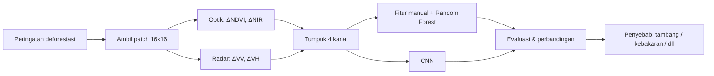
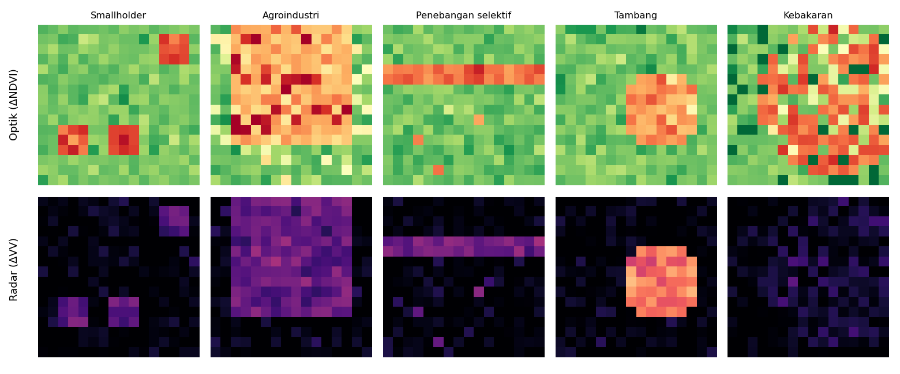
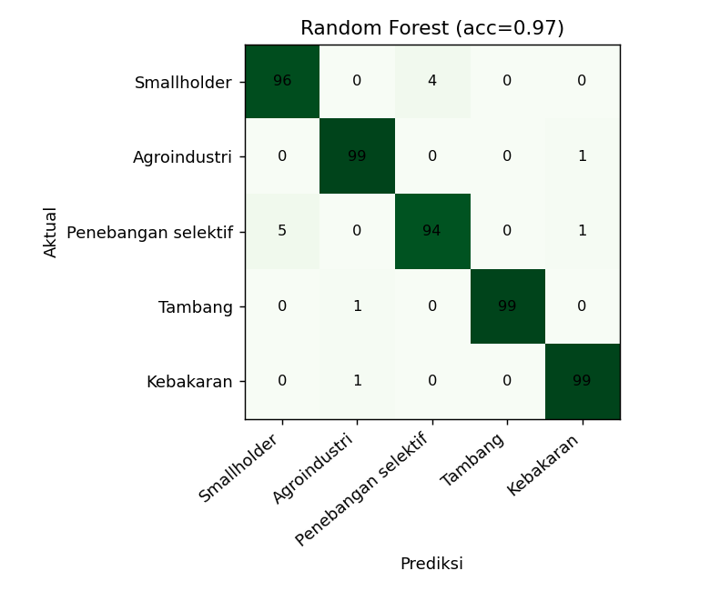

<div align="center">

# 🌳 Forest Driver AI

### Klasifikasi Penyebab Deforestasi Tropis dari Citra Satelit Optik + Radar menggunakan CNN


-blue)

*Studi kasus edukatif berdasarkan materi Sesi 6: "Pemantauan Perubahan Hutan Tropis Menggunakan Data Satelit Multi-Sensor dan Kecerdasan Buatan" oleh Dr. Bart Slachter (Wageningen University and Research).*

</div>

---

## 📑 Daftar Isi
1. [Latar Belakang](#-latar-belakang)
2. [Rumusan Masalah & Tujuan](#-rumusan-masalah--tujuan)
3. [Batasan Masalah](#-batasan-masalah)
4. [Pendekatan & Alur Kerja](#-pendekatan--alur-kerja)
5. [Struktur Proyek](#-struktur-proyek)
6. [Cara Menjalankan](#-cara-menjalankan)
7. [Hasil](#-hasil)
8. [Pemetaan ke Materi Pemateri](#-pemetaan-ke-materi-pemateri)
9. [Keterbatasan](#-keterbatasan)
10. [Pengembangan Lanjutan](#-pengembangan-lanjutan)

---

## 🌍 Latar Belakang

Hutan tropis menyimpan karbon, mengatur siklus air, dan menjadi rumah keanekaragaman hayati. Sistem peringatan deforestasi (*deforestation alerts*) berbasis satelit sudah mampu mendeteksi hilangnya pohon hampir setiap minggu pada resolusi 10-30 m. Namun sistem tersebut hanya menjawab **di mana** pohon hilang, bukan **mengapa**.

Padahal, penyebab menentukan intervensi: tambang ilegal butuh penegakan hukum, ladang smallholder butuh pendekatan sosial-ekonomi, dan kebakaran butuh mitigasi lain lagi.

> **Ide utama materi:** gabungkan citra **optik** (Sentinel-2) dan **radar** (Sentinel-1) dengan **Deep Learning (CNN)** untuk mengklasifikasikan penyebab langsung setiap peringatan deforestasi.

## 🎯 Rumusan Masalah & Tujuan

**Pertanyaan studi kasus:**
1. Bisakah patch citra multi-sensor diklasifikasikan ke dalam lima penyebab deforestasi?
2. Apakah CNN lebih baik dibanding *Machine Learning* konvensional dengan fitur manual? (sesuai saran pemateri untuk selalu membandingkan keduanya)
3. Pada kelas mana model paling sering keliru?

**Tujuan:** membangun prototipe sederhana, dapat dijalankan di laptop biasa tanpa GPU, untuk memahami alur kerja klasifikasi penyebab deforestasi.

## 🚧 Batasan Masalah

| No | Batasan | Alasan |
|----|---------|--------|
| 1 | Menggunakan **data sintetis**, bukan citra Sentinel asli | Sederhana, cepat, tanpa akses GEE/unduhan data besar |
| 2 | Input berupa patch **16x16 piksel, 4 kanal** (ΔNDVI, ΔNIR, ΔVV, ΔVH) | Meringankan komputasi |
| 3 | Hanya **5 kelas**: smallholder, agroindustri, penebangan selektif, tambang, kebakaran | Disederhanakan dari materi (jalan & banjir tidak dimasukkan) |
| 4 | Satu patch = satu peringatan deforestasi, **tanpa dimensi waktu** (bukan time series bulanan) | Penyederhanaan |
| 5 | Tidak ada validasi lapangan (*field data*) | Pada studi nyata ini wajib (lihat materi) |
| 6 | Pola kelas dirancang manual berdasarkan bentuk dan karakteristik umum | Akurasi tinggi **tidak** mencerminkan performa di dunia nyata |
| 7 | CNN kecil (3 lapisan konvolusi), dilatih di CPU | Fokus pada konsep, bukan performa maksimal |

## 🧠 Pendekatan & Alur Kerja



**Karakteristik kelas pada data sintetis** (meniru logika materi):

| Kelas | Bentuk area gundul | Ciri sensor |
|-------|--------------------|-------------|
| Smallholder | Bercak kecil tersebar | Radar sedang |
| Agroindustri | Blok besar berbentuk persegi panjang | Radar sedang |
| Penebangan selektif | Jalur tipis + bercak kecil | Radar lemah |
| Tambang | Area kompak sedang | Perubahan radar **kuat** |
| Kebakaran | Bercak luas bergerigi | NIR turun tajam, radar **lemah** |

Gangguan **awan** disimulasikan hanya pada kanal optik, untuk menunjukkan alasan radar dibutuhkan di wilayah tropis.

## 📁 Struktur Proyek

```
forest-driver-ai/
├── README.md
├── requirements.txt
├── LICENSE
├── .gitignore
├── src/
│   ├── data.py       # generator data sintetis
│   ├── features.py   # fitur manual untuk baseline
│   ├── cnn.py        # arsitektur & pelatihan CNN (PyTorch)
│   └── main.py       # pipeline utama
└── results/          # gambar & ringkasan hasil
```

## ▶️ Cara Menjalankan

```bash
# 1. Clone & masuk folder
git clone https://github.com/SxCentauri/forest-driver-ai.git
cd forest-driver-ai

# 2. (Opsional) buat virtual environment
python -m venv .venv && source .venv/bin/activate   # Windows: .venv\Scripts\activate

# 3. Pasang dependensi
pip install -r requirements.txt

# 4. Jalankan
python src/main.py                 # Random Forest + CNN
python src/main.py --skip-cnn      # hanya baseline (tanpa PyTorch)
python src/main.py --n 800 --epochs 25   # data lebih banyak
```

Waktu proses sekitar beberapa menit di CPU biasa.

## 📊 Hasil

Contoh patch sintetis (baris atas: optik, baris bawah: radar):



**Baseline Random Forest** (2.000 patch, 25% data uji):

| Model | Akurasi |
|-------|---------|
| Random Forest + fitur manual | **97,4%** |
| CNN | Dijalankan oleh pengguna: hasil tersimpan di `results/ringkasan.txt` dan `results/cm_cnn.png` |



> ⚠️ **Catatan penting:** akurasi tinggi muncul karena data sintetis dibuat dengan pola yang jelas. Pada citra satelit asli, hasilnya akan jauh lebih sulit. Angka di atas tidak boleh dianggap sebagai performa dunia nyata. Pada pengembangan ini, bagian CNN belum dieksekusi di lingkungan penulis (PyTorch tidak terpasang), sehingga silakan jalankan sendiri dan isi hasilnya.

## 🔗 Pemetaan ke Materi Pemateri

| Konsep di materi | Implementasi di proyek |
|------------------|------------------------|
| Optik + radar (Sentinel-2 + Sentinel-1) | 4 kanal: ΔNDVI/ΔNIR dan ΔVV/ΔVH |
| Radar menembus awan | Noise awan hanya pada kanal optik |
| CNN membaca konteks spasial | `SmallCNN` pada patch 16x16 |
| Klasifikasi penyebab langsung | 5 kelas penyebab |
| Bandingkan DL vs ML konvensional | Random Forest vs CNN |
| Ambiguitas klasifikasi (kebakaran vs lainnya) | Terlihat di confusion matrix |
| Validasi lapangan tetap wajib | Dibahas di bagian Keterbatasan |

## ⚠️ Keterbatasan
- Data sintetis tidak menangkap kompleksitas lanskap nyata.
- Tidak ada dimensi temporal, musim, maupun *latency* bulanan seperti di sistem nyata.
- Penyebab sosial (mis. ladang vs produksi arang) tidak bisa dibedakan dari citra, dan pada studi ini tidak dimodelkan.
- Model belum diuji lintas wilayah (Amazon, Kongo, Kalimantan).

## 🚀 Pengembangan Lanjutan
- [ ] Ganti data sintetis dengan patch Sentinel-1/2 asli (Google Earth Engine / Planetary Computer) dan label dari dataset penyebab deforestasi publik.
- [ ] Tambah dimensi waktu (tumpukan citra bulanan, 3D-CNN / ConvLSTM).
- [ ] Tambah kelas jalan dan banjir.
- [ ] Studi khusus Kalimantan/Sumatra, termasuk Bengkulu.
- [ ] Validasi dengan data lapangan.

## 📚 Referensi
- Slachter, B. *Pemantauan Perubahan Hutan Tropis Menggunakan Data Satelit Multi-Sensor dan AI* (Sesi 6).
- Global Forest Watch: https://www.globalforestwatch.org
